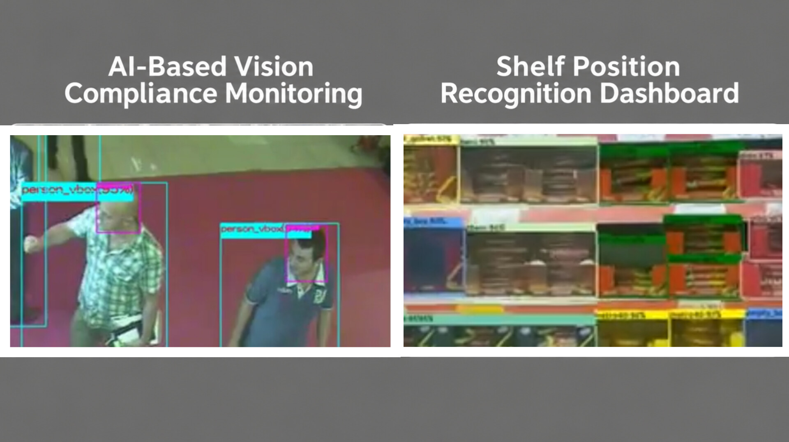

About me

# 🏷 AI & Computer Vision Engineer

I'm an AI Engineer specializing primarily in **Computer Vision**, with a strong foundation in **Machine Learning and Deep Learning**. I focus on developing practical, scalable AI solutions that address real-world challenges.

My core areas of interest include **Image Processing, Object Detection, Image Segmentation, and Document OCR**. I enjoy transforming complex visual problems into intelligent and efficient solutions using modern computer vision techniques and deep learning architectures.

I also work on **ML/DL model development, training, evaluation, and optimization**, with an emphasis on building effective and reliable AI solutions.

## 🛄 Languages & Frameworks

### Programming Languages 

- **Python:** Proficient in Python, with the ability to write clean, modular, maintainable, and scalable code. Comfortable navigating large codebases, understanding existing implementations, and contributing to complex software projects.

- **C++:** Basic proficiency in C++, with the ability to write basic programs and work with fundamental language concepts.

### Computer Vision

- **OpenCV:** Primary toolkit for image processing, video analysis, and computer vision applications.
- **Ultralytics YOLO & RT-DETR:** Strong expertise in object detection, model architectures, version comparison, and performance evaluation.
- **ONNX:** Model export and cross-platform inference for deployment across different hardware.
- **MediaPipe:** Real-time pose estimation and human movement analysis.
- **PaddleOCR:** Document OCR and text extraction, including complex document layouts.
- **EasyOCR:** Lightweight OCR and text recognition solutions.

### Deep Learning

- **PyTorch:** Primary deep learning framework. Proficient in working with official documentation, implementing research papers, and translating research concepts into practical PyTorch implementations.
- **TensorFlow & Keras:** Familiar with model development and training, with a primary focus on PyTorch.

### Data & Scientific Computing

- NumPy
- Pandas
- Matplotlib
- SciPy
- Scikit-learn

## 📄 Freelance & Real-World Projects

### 1. AI-Based Vision Compliance Monitoring

Domain: Industrial Computer Vision & Real-Time Video Analytics

Developed an AI-powered video analytics solution for monitoring workplace safety and hygiene compliance using computer vision techniques.

Key Contributions:

- Fine-tuned object detection models using custom annotations provided by the client.
- Worked with crowded-scene datasets to improve detection performance in dense environments.
- Performed model training, experimentation, and evaluation using the company's GPU infrastructure.
- Addressed multi-camera inference challenges for a deployment scenario involving up to 50 camera streams.
- Optimized inference using FP16 (half-precision) to improve GPU resource utilization and processing efficiency.
- Integrated NVIDIA DeepStream to build a GPU-accelerated video analytics pipeline.
- Evaluated and utilized YOLO-N models to balance detection accuracy and computational efficiency.
- Achieved an average processing throughput of 12.5 FPS on an NVIDIA RTX PRO 4000 Blackwell GPU.
- Focused on people detection and visual analysis of workplace safety and hygiene compliance conditions.

Performance & Deployment:

- Target deployment scale: Up to 50 concurrent camera streams.
- Per-camera processing throughput: 12.5 FPS.
- Aggregate processing throughput: 625 FPS across 50 camera streams.
- Inference optimization: FP16 (Half-Precision).
- Video analytics framework: NVIDIA DeepStream.
- GPU: NVIDIA RTX PRO 4000 Blackwell.

Technologies: Python, PyTorch, OpenCV, Ultralytics YOLO, NVIDIA DeepStream, FP16, NVIDIA GPU Computing

### 2. Shelf Position Recognition Dashboard

**Domain:** Retail Computer Vision & Product Recognition

Developed a Computer Vision proof of concept for detecting misplaced products on retail shelves by comparing detected product positions against predefined planograms.

**Key Contributions:**
- Designed a product detection and shelf-position validation pipeline.
- Processed shelf images and mapped detected products to predefined shelf zones.
- Implemented planogram-based position verification.
- Designed visual feedback to highlight correctly placed and misplaced products.

**Technologies:** Python, OpenCV, YOLO, Computer Vision

# 🛠️ Software & Tools

